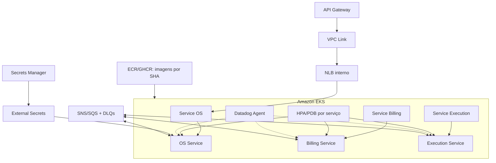

# Oficina Kubernetes Infrastructure

Infraestrutura como código da plataforma Amazon EKS, rede, imagens, workloads Kubernetes, elasticidade e observabilidade da oficina.

## O que este repositório entrega

- VPC em duas AZs, sub-redes públicas/privadas, rotas e NAT configurável;
- Amazon EKS com Managed Node Group e addons essenciais;
- Amazon ECR com imagens imutáveis por SHA;
- NLB interno para integração privada com API Gateway;
- Deployment, Service, probes, requests/limits e segurança não-root;
- HPA de 2 a 6 réplicas e PodDisruptionBudget;
- External Secrets, AWS Load Balancer Controller e Cluster Autoscaler;
- Datadog Agent, dashboards e monitores;
- Terraform e pipelines CI/CD separados por ambiente.



## Documentação

- [Arquitetura, objetivos, decisões e limitações](docs/arquitetura-e-decisoes.md)
- [Procedimento de implantação](docs/deployment.md)
- [CI/CD](docs/cicd.md)
- [Dashboards e monitores](docs/dashboards.md)
- [Governança do repositório](docs/governanca-repositorio.md)
- [Arquitetura final da Fase 4](https://github.com/maypinheiro/oficina-api/blob/main/docs/fase4/arquitetura-alvo.md)
- [Saga, caminho feliz e compensações](https://github.com/maypinheiro/oficina-api/blob/main/docs/fase4/saga-orquestrada.md)
- [Observabilidade distribuída da Fase 4](https://github.com/maypinheiro/oficina-api/blob/main/docs/fase4/fase10-observabilidade-distribuida.md)
- [Matriz de conformidade da Fase 4](https://github.com/maypinheiro/oficina-api/blob/main/docs/fase4/matriz-conformidade.md)
- [Catálogo de evidências da Fase 4](https://github.com/maypinheiro/oficina-api/blob/main/docs/fase4/catalogo-evidencias.md)
- [Decisões arquiteturais da Fase 4](https://github.com/maypinheiro/oficina-api/tree/main/docs/fase4/adrs)
- [Arquitetura integrada da solução](https://github.com/maypinheiro/oficina-api/blob/main/docs/fase3/entrega-tecnica.md)
- [ADR do EKS](https://github.com/maypinheiro/oficina-api/blob/main/docs/fase3/adrs/adr-003-amazon-eks.md)
- [ADR do HPA](https://github.com/maypinheiro/oficina-api/blob/main/docs/fase3/adrs/adr-004-hpa.md)
- [Matriz completa de conformidade](https://github.com/maypinheiro/oficina-api/blob/main/docs/fase3/matriz-conformidade.md)
- [Guia de demonstração do HPA/Datadog](https://github.com/maypinheiro/oficina-api/blob/main/docs/fase3/guia-demonstracao-e-aceite.md)
- [Entrega final e vídeo](https://github.com/maypinheiro/oficina-api/blob/main/docs/fase3/entrega-final.md)

Repositórios relacionados: [OS Service](https://github.com/maypinheiro/oficina-api),
[Billing Service](https://github.com/maypinheiro/oficina-billing-service),
[Execution Service](https://github.com/maypinheiro/oficina-execution-service),
[autenticação](https://github.com/maypinheiro/oficina-auth-function) e
[banco do OS](https://github.com/maypinheiro/oficina-database-infra).

### Rastreabilidade da infraestrutura da Fase 4

| Requisito | Evidência |
|---|---|
| Kubernetes | EKS em `infra/cluster.tf` e manifests em cada repositório de serviço |
| Deploy independente | workflow de CD e imagem imutável por SHA em OS, Billing e Execution |
| Elasticidade e disponibilidade | HPA, PDB, probes, requests/limits e RollingUpdate por serviço |
| Mensageria | SNS, filas SQS e DLQs provisionados pelos módulos dos serviços/orquestrador |
| Observabilidade da Fase 3 reutilizada | Agent/Cluster Agent, quatro dashboards e monitores em `infra/` e `observability/` |
| Rastreamento distribuído | tags `service/env/version` e IDs `correlationId`/`sagaId` |
| Ambientes | `homolog` → `hml`; `main` → `prod` protegido por GitHub Environment |

### API publicada e Swagger

Este repositório não expõe uma API própria. A infraestrutura provisionada sustenta a API e o Swagger compartilhados:

- Swagger/OpenAPI: <https://9o7vnq3io0.execute-api.us-east-1.amazonaws.com/docs/>
- URL base do API Gateway: <https://9o7vnq3io0.execute-api.us-east-1.amazonaws.com>

## Tecnologias

Terraform, AWS VPC/EKS/ECR, Kubernetes, Helm, HPA, PDB, Metrics Server, External Secrets, Datadog e GitHub Actions.

## Validação local

```bash
terraform -chdir=infra fmt -check -recursive
terraform -chdir=infra init -backend=false
terraform -chdir=infra validate
kubectl apply --dry-run=client -f k8s/
```

Os manifests de PostgreSQL e Metrics Server usados na fase local são legado e não representam o banco cloud. PostgreSQL é executado no RDS.

## CI/CD e ordem de implantação

CI valida Terraform, segurança e manifests. O workflow `Provision EKS` aplica rede/cluster e instala controllers. A ordem cloud é: EKS/rede, RDS, API/migrations e Functions/Gateway. Rollback usa commit/plan ou SHA conhecido; não se edita state nem se destrói o cluster como diagnóstico.

### Como executar o provisionamento

1. Atualize as credenciais temporárias e chaves Datadog no GitHub Environment.
2. Abra **Actions → Provision EKS → Run workflow** e escolha `hml` ou `prod`.
3. O workflow aplica Terraform, valida nodes/endpoint e instala External Secrets, Load Balancer Controller, Cluster Autoscaler e Datadog.
4. Preserve o artefato `eks-outputs-<env>-<sha>`; seus outputs alimentam os demais repositórios.
5. Prossiga com RDS, API e Functions, nesta ordem.

O workflow usa `workflow_run` para provisionar automaticamente `hml` após CI verde em `homolog` e `prod` após CI verde em `main`. O disparo manual continua disponível para contingência, e produção permanece protegida pela aprovação do GitHub Environment.

## Ambiente validado e limitações

- Conta acadêmica atual `508274625814`, região `us-east-1`. O Learner Lab anterior (`982623100545`) foi encerrado e seus recursos não estão mais acessíveis;
- homologação e Datadog validados: <https://github.com/maypinheiro/oficina-k8s-infra/actions/runs/34776527610>;
- produção permanece codificada e isolada, condicionada ao orçamento do laboratório.

Dashboards provisionados: [API](https://app.datadoghq.com/dashboard/uhc-x7j-d3i), [Kubernetes/HPA](https://app.datadoghq.com/dashboard/cfp-bd3-ayn) e [Ordens de serviço](https://app.datadoghq.com/dashboard/i9b-paf-7z5).

Credenciais STS do Learner Lab expiram. Controllers que acessam AWS precisam receber a sessão atual; após renovar os secrets do GitHub, execute novamente o provisionamento ou o CD da API. EKS, nodes, NAT e NLB geram custo enquanto ativos.
